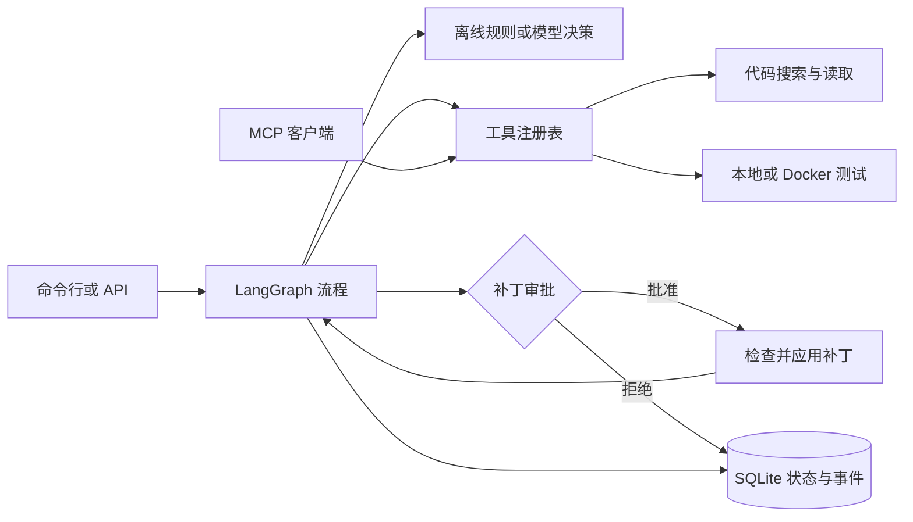

# RepoPilot

面向 Git 代码仓库的 Coding Agent，支持代码搜索与读取、修改补丁提议、人工审批、测试执行和过程记录。使用 Python、LangGraph、FastAPI、tree-sitter 和 SQLite 实现。

核心流程是检查代码、选择操作、提出补丁、人工确认、应用修改、执行测试和保存结果。提供离线规则模式，便于在没有模型密钥时演示流程。

## 主要功能

- 使用精确搜索、词频相似度排序和 tree-sitter 声明查找定位代码，读取时保留行号。
- 通过 LangGraph 组织决策、工具执行、补丁提议、审批和结束五个节点。
- 以 unified diff 展示修改，审批后检查路径，并执行 `git apply --check` 再应用补丁。
- 提供本地与 Docker 测试执行模式，记录退出码、输出和耗时。
- SQLite 保存运行状态、待审批补丁和有序事件，API 提供状态查询与 SSE 事件流。
- 设置总步数和相同操作重复次数限制，提供可重复的离线示例评测。

## 架构



待审批补丁保存在 SQLite 中。已有测试覆盖重建引擎后读取补丁、批准并继续执行的场景。

## 快速启动

需要 Python 3.11 或更高版本，以及 Git。以下命令在 PowerShell 中执行。

```powershell
python -m venv .venv
.\.venv\Scripts\Activate.ps1
pip install -e ".[dev]"

# 创建包含演示缺陷的独立 Git 仓库
repopilot prepare-demo .demo/buggy_calculator

# 演示固定替换流程，自动审批适用于这类受控示例
repopilot run .demo/buggy_calculator 'Replace "return a - b" with "return a + b" in calculator.py' --test-command "python -m pytest -q" --auto-approve
```

离线模式支持 `Replace "old" with "new" in path` 形式，按固定流程完成文本替换。一般代码需求需要配置支持工具调用的模型服务。

```powershell
$env:REPOPILOT_PROVIDER="openai_compatible"
$env:REPOPILOT_API_BASE="https://your-endpoint.example/v1"
$env:REPOPILOT_API_KEY="填写模型服务密钥"
$env:REPOPILOT_MODEL="填写支持工具调用的模型名称"
repopilot run C:\path\to\repo "修复指定问题，并运行相关测试" --provider openai_compatible --model "填写模型名称"
```

完整配置字段见 [.env.example](.env.example)。模型路径需要结合实际服务完成联调与任务评估。

## API 服务

默认只接受当前工作目录下的仓库。可通过环境变量设置允许目录，多个目录在 Windows 下使用分号分隔，在 Linux 下使用冒号分隔。

```powershell
$env:REPOPILOT_ALLOWED_ROOTS="D:\work"
repopilot serve --host 127.0.0.1 --port 8000
```

访问 `http://127.0.0.1:8000/docs` 查看交互式接口文档。

| 方法 | 接口 | 用途 |
|---|---|---|
| POST | `/api/runs` | 创建并启动运行 |
| GET | `/api/runs` | 查看运行列表 |
| GET | `/api/runs/{id}` | 查询状态、补丁和指标 |
| POST | `/api/runs/{id}/approval` | 批准或拒绝待审批补丁 |
| GET | `/api/runs/{id}/events` | 查询执行事件 |
| GET | `/api/runs/{id}/events/stream` | 通过 SSE 接收新增事件 |

创建运行的请求示例。

```json
{
  "repository_path": "D:/work/calculator",
  "issue": "Replace \"return a - b\" with \"return a + b\" in calculator.py",
  "test_command": "python -m pytest -q",
  "auto_approve": false,
  "provider": "offline"
}
```

## MCP 工具

```powershell
repopilot-mcp
```

stdio MCP 服务提供文件列表、精确搜索、声明定位、文件读取、Git diff、补丁路径检查和本地测试执行七个工具。补丁写入由 Agent 的审批流程处理。

## 测试与评测

```powershell
python -m pytest
repopilot eval evals/tasks.example.yaml --output .repopilot/evaluation.json
```

测试覆盖路径与命令检查、补丁应用、tree-sitter 定位、测试执行、审批和待审批恢复等行为。

评测把示例复制到临时 Git 仓库，执行离线任务，检查预期文件的修改情况，并统计状态、耗时和工具调用次数。[基线报告](evals/baseline.json) 来自一个简单替换任务。扩展清单包含重复任务，统计时需要核对独立任务数量。

## Docker

```powershell
docker compose up --build
```

Compose 启动 API 服务。若要在独立 Docker 容器中执行测试，需要在可访问 Docker 的环境设置 `REPOPILOT_SANDBOX_MODE=docker` 和 `REPOPILOT_DOCKER_IMAGE`。默认镜像名为 `repopilot:latest`。

Docker 模式配置了断网、移除 Linux capabilities、`no-new-privileges` 以及 CPU、内存和进程数限制，运行验证待补。本地模式适合可信开发仓库，测试代码仍具有当前进程的系统权限。

## 当前范围与后续工作

当前主要验证离线规则流程和本地单服务运行。名为 `semantic_search` 的工具使用词频与余弦相似度。LangGraph 检查点保存在内存中，重启恢复主要覆盖待审批补丁场景。

测试失败后已应用的修改会保留。通用模型路径的最终状态采用模型的结束决定，结束前还需补充独立的测试成功检查。

后续可补充真实模型任务评估、身份认证、用户工作区隔离、同仓库并发修改控制、持久化执行队列和独立容器工作进程。详见 [架构与执行限制](docs/architecture.md)。

## 文件用途说明

每个已提交文件均列出中文用途，点击路径可查看内容。

### 配置与项目文档

| 文件 | 用途 |
|---|---|
| [.dockerignore](.dockerignore) | 排除容器构建中的虚拟环境、运行数据和缓存 |
| [.env.example](.env.example) | 模型服务、允许目录、数据库和测试执行的配置示例 |
| [.gitattributes](.gitattributes) | 约定文本文件与换行格式 |
| [.gitignore](.gitignore) | 排除本地密钥、数据库、缓存和个人学习资料 |
| [Dockerfile](Dockerfile) | 构建包含 Python、Git 和项目依赖的服务镜像 |
| [LICENSE](LICENSE) | 项目的 MIT 许可证 |
| [README.md](README.md) | 项目介绍、启动流程、接口和文件用途索引 |
| [compose.yaml](compose.yaml) | 配置 API 容器、端口、环境变量和数据卷 |
| [docs/architecture.md](docs/architecture.md) | 说明 Agent 流程、执行限制和恢复范围 |
| [pyproject.toml](pyproject.toml) | 定义依赖、命令行入口和开发工具配置 |

### Agent 与服务代码

| 文件 | 用途 |
|---|---|
| [src/repopilot/__init__.py](src/repopilot/__init__.py) | 定义 Python 包和版本信息 |
| [src/repopilot/agent.py](src/repopilot/agent.py) | 编排决策、工具执行、补丁审批、恢复与结束 |
| [src/repopilot/api.py](src/repopilot/api.py) | 提供 FastAPI 接口、服务首页和 SSE 事件流 |
| [src/repopilot/cli.py](src/repopilot/cli.py) | 提供运行、审批、演示准备、评测和服务启动命令 |
| [src/repopilot/config.py](src/repopilot/config.py) | 读取环境配置并校验模型及执行参数 |
| [src/repopilot/evaluation.py](src/repopilot/evaluation.py) | 复制示例仓库、执行评测并汇总结果 |
| [src/repopilot/mcp_server.py](src/repopilot/mcp_server.py) | 通过 stdio MCP 暴露仓库检查和本地测试工具 |
| [src/repopilot/models.py](src/repopilot/models.py) | 定义请求、运行状态、工具调用、事件和指标数据结构 |
| [src/repopilot/providers.py](src/repopilot/providers.py) | 实现离线替换规则和模型工具调用决策 |
| [src/repopilot/repository.py](src/repopilot/repository.py) | 实现文件读取、代码检索、声明定位和 Git 补丁应用 |
| [src/repopilot/sandbox.py](src/repopilot/sandbox.py) | 在本地或 Docker 中执行命令并记录结果 |
| [src/repopilot/security.py](src/repopilot/security.py) | 检查允许目录、文件路径、命令和补丁路径 |
| [src/repopilot/store.py](src/repopilot/store.py) | 使用 SQLite 保存运行记录和有序事件 |
| [src/repopilot/tools.py](src/repopilot/tools.py) | 定义工具参数并分派到具体处理函数 |

### 评测与演示材料

| 文件 | 用途 |
|---|---|
| [evals/baseline.json](evals/baseline.json) | 保存单个离线任务的本地基线结果 |
| [evals/tasks.example.yaml](evals/tasks.example.yaml) | 定义最小离线评测任务 |
| [evals/tasks_extended.yaml](evals/tasks_extended.yaml) | 扩展示例任务清单，包含重复与不同替换任务 |
| [examples/buggy_calculator/README.md](examples/buggy_calculator/README.md) | 介绍计算器演示缺陷 |
| [examples/buggy_calculator/calculator.py](examples/buggy_calculator/calculator.py) | 包含加法误写为减法的演示代码 |
| [examples/buggy_calculator/tests/test_calculator.py](examples/buggy_calculator/tests/test_calculator.py) | 验证计算器的加减法行为 |
| [examples/grade_checker/grade_checker.py](examples/grade_checker/grade_checker.py) | 提供成绩边界比较错误示例 |
| [examples/grade_checker/tests/test_grade_checker.py](examples/grade_checker/tests/test_grade_checker.py) | 验证成绩阈值和边界行为 |
| [examples/string_utils/string_utils.py](examples/string_utils/string_utils.py) | 提供字符串方法遗漏调用括号的示例 |
| [examples/string_utils/tests/test_string_utils.py](examples/string_utils/tests/test_string_utils.py) | 验证大写转换和空白清理 |
| [examples/validator/tests/test_validator.py](examples/validator/tests/test_validator.py) | 验证判断函数的预期行为 |
| [examples/validator/validator.py](examples/validator/validator.py) | 提供正数与偶数判断中的取反错误示例 |

### 自动化测试

| 文件 | 用途 |
|---|---|
| [tests/conftest.py](tests/conftest.py) | 创建测试使用的临时 Git 仓库 |
| [tests/test_agent.py](tests/test_agent.py) | 验证离线修复、人工审批和待审批恢复 |
| [tests/test_api.py](tests/test_api.py) | 验证服务健康、运行创建与接口流程 |
| [tests/test_repository.py](tests/test_repository.py) | 验证代码搜索、声明定位、补丁应用和换行处理 |
| [tests/test_sandbox.py](tests/test_sandbox.py) | 验证本地测试命令执行 |
| [tests/test_security.py](tests/test_security.py) | 验证基础路径、命令和补丁检查 |
| [tests/test_security_extended.py](tests/test_security_extended.py) | 验证更多路径越界、命令拼接和补丁异常案例 |
| [tests/test_store.py](tests/test_store.py) | 验证 SQLite 操作结束后释放数据库文件 |
