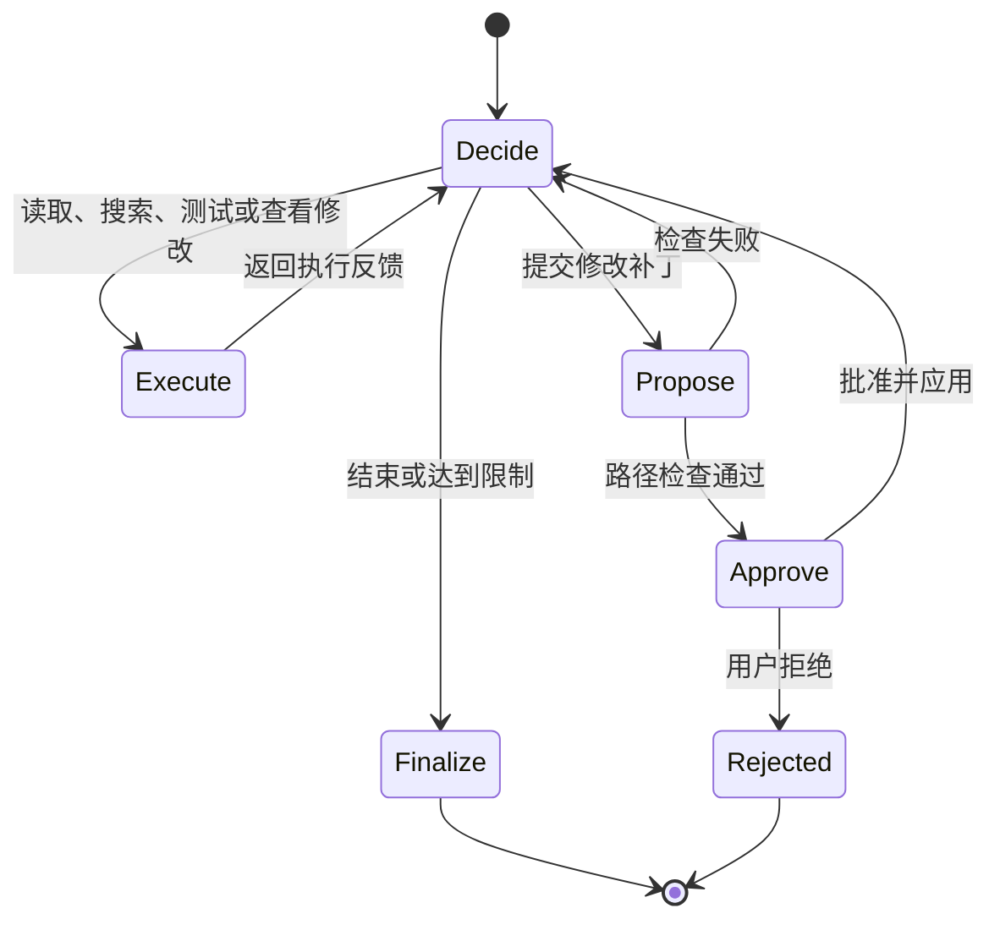

# RepoPilot 架构与执行限制

## Agent 状态流转

模型返回工具名称和 JSON 参数，由程序根据注册表执行。补丁提议先检查路径，再进入审批。批准后重新检查路径，并执行 `git apply --check` 检查当前文件，之后应用。单次运行可显式开启自动审批，适合受控示例与评测。

## 执行边界

| 环节 | 当前处理 | 需要关注的情况 |
|---|---|---|
| 仓库选择 | 解析后的目录需要位于允许范围，且包含 `.git` | 允许范围内也可能有不可信仓库 |
| 文件访问 | 检查绝对路径、上级路径和解析后的实际位置 | 大文本仍可能占用上下文，需要限制读取范围 |
| 补丁应用 | 检查路径并执行 `git apply --check` | 可应用的补丁仍需要审核逻辑是否正确 |
| 本地测试 | 参数列表、命令检查、超时和结果输出截断 | 测试代码具有当前用户权限，输出先被捕获再截断 |
| Docker 测试 | 配置断网、权限与资源限制 | 需要实际运行验证，挂载仓库仍可写入 |
| 模型调用 | 地址和密钥由服务配置提供 | 上下文包含仓库片段，需要按实际数据使用要求配置 |

本地执行适用于可信开发仓库。运行不可信代码时，需要验证容器配置和宿主机访问范围。

## 状态保存与恢复

SQLite 保存运行记录、待审批补丁和有序事件。LangGraph 当前使用内存检查点维护暂停位置。

等待审批期间重启后，可从 SQLite 读取补丁，批准后检查并应用，再从应用结果重建后续状态。已有自动化测试覆盖该场景，其他步骤的持续恢复仍需扩展。

## 循环与失败处理

- 每次运行设置总步数上限。
- 工具名与规范化 JSON 参数组成操作签名，重复超过限制后结束。
- 工具异常保存为反馈，供下一轮决策使用。
- 测试工具保留退出码和输出，离线模式测试失败后结束。
- 通用模型模式的结束状态来自模型提交的结果，结束前还需补充独立的测试成功检查。
- 事件记录决策、参数、补丁、工具输出、耗时和最终指标。

## 决策模块

离线模块按固定替换规则运行，支持 `Replace "old" with "new" in path` 形式，用于可重复的流程验证。

模型模块通过兼容的 `/chat/completions` 接口发送工具定义，读取模型选择的工具名称和参数，实际任务表现需要单独评测。

## 后续方向

补充身份认证、用户工作区隔离、同仓库并发修改控制、持久化执行队列、独立容器工作进程、日志敏感信息处理及人工审核的真实问题评测集。
